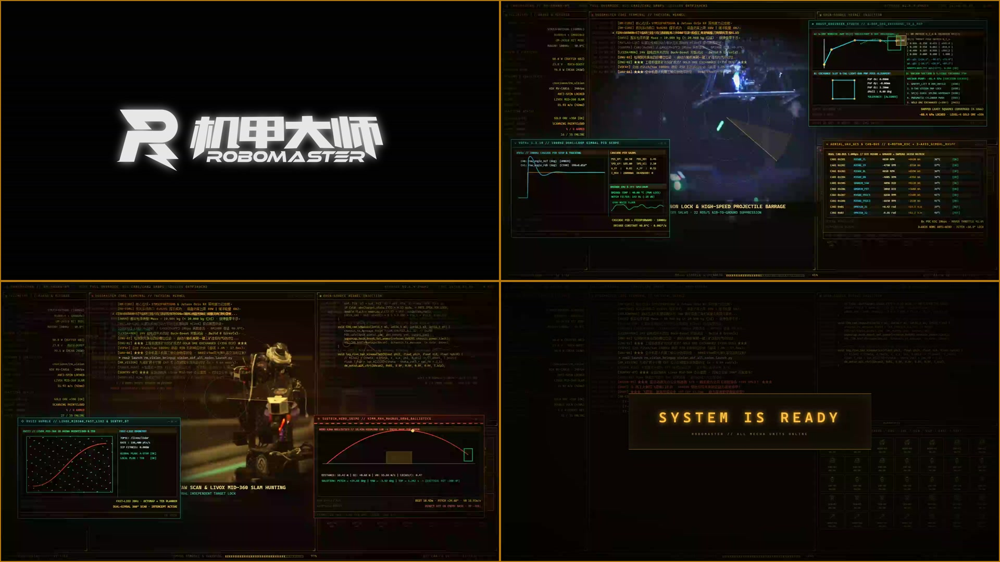

# dsh-robomaster-boot

> **RoboMaster 开机动画（官方 Logo 版）** (Official RoboMaster Logo Edition · 大疆 RoboMaster 官方原版机甲大师横版组合徽标)  
> 专为 **DeepSeek Harness (`DSH >= 0.2.0-rc.1 / 0.2.0-rc.2`)** 打造的 RoboMaster 机甲大师战术全息开机动画插件。



---

## 💡 创作灵感与致敬 (Inspiration & Homage)

本期作品将 **RoboMaster 机甲大师赛场高燃名场面** 与 **战队备赛四大研发组别（机械 / 硬件 / 电控 / 视觉导航）的硬核工程流** 融为一体，在视觉呈现与编排节奏上致敬并借鉴了以下两部经典作品：

1. **网络爆火的 550C DSH 开机动画**：借鉴了其极具工业仪式感的琥珀色 CRT 磷光终端自检骨架、错位层叠弹出的高密度工程软件窗口、原曲《SLOW MOTION (CASTLE. Remix)》的鼓点卡点编排，以及终幕双竖线激光拉出 `SYSTEM IS READY` 的收尾设计。
2. **《命令与征服：红色警戒》（Command & Conquer: Red Alert）主页与战术简报动画**：借鉴了红警经典的复古未来主义全息雷达投影美学——包括三栏四区战术控制台、径向扫描十字准星、Canny 边缘荧光轮廓强化、双路画中画（PiP）实时战术监控窗，以及底部 7 大机甲兵种武器遥测卡片阵列。

---

## 🎬 动画收录名场面与七大兵种全息切片 (Iconic Moments & 7 Robot Classes)

全片共 **22.0 秒（1080P @ 60fps）**，严格甄选 **0 人脸、0 宣传字幕** 的纯机甲微距特写与第一视角（FPV）赛场高光镜头，完整覆盖 RoboMaster 全部 **7 大经典兵种**：

| 阶段 / 兵种 | 时间轴 | 收录赛场名场面与高光镜头说明 |
| :--- | :---: | :--- |
| **片头 · 机甲徽标激光扫描** | `0.00s - 2.15s` | 片头采用 **大疆 RoboMaster 官方原版机甲大师横版组合徽标**（左侧斜体锋翼 `R` 图标 + 右侧 `机甲大师 / ROBOMASTER` 一体式机甲字标），由高能红色垂直激光束从左至右逐段扫描点亮，并同步触发步兵 C 板电调上电「滴滴滴—滴—」标志性自检音。 |
| **01 · 五连杆轮腿平衡步兵**<br>`Wheel-Leg Balance Infantry` | `2.15s - 5.10s` | **飞坡腾空与单侧着地极限平衡**：收录上海交大 / 南航等强队五连杆轮腿步兵高速飞跃赛场斜坡、落地瞬间关节电机主动吸能缓冲、单轮着地极限救车与高速过障名场面。 |
| **02 · 全向轮 / 舵轮步兵**<br>`Omni & Swerve Infantry` | `5.10s - 6.95s` | **28 rad/s 高速小陀螺机动**：收录舵轮/麦轮步兵在密集弹雨中开启高速「小陀螺」（Spin-Top）边旋转边精准反击、动力总成与碳板连杆高速运转微距特写。 |
| **03 · 工程机器人**<br>`Engineer Robot` | `6.95s - 8.78s` | **三矿同抓与极速视觉对位兑矿**：收录合工大三矿霸气同抓、港科大 6 自由度机械臂在兑换槽前毫秒级六维姿态解算、金矿推入亮灯得分名场面。 |
| **04 · 空中机器人（无人机）**<br>`Aerial Robot / UAV` | `8.78s - 10.40s` | **云台锁定与空中高速连发弹丸倾泻**：收录空中机器人共轴双桨悬停、云台跨半场死死咬住地面目标，以及**发射机构高速连发弹丸倾泻火力**的硬核实机画面。 |
| **05 · 英雄机器人**<br>`Hero Robot` | `10.40s - 13.85s` | **42mm 大弹丸发射机构微距 & 超远吊射破防**：收录太原理工英雄机器人 42mm 摩擦轮发射机构精密上膛特写，以及南科大英雄超远距离跨地形抛物线「吊射」（Lob Shot）一击打爆前哨站/基地护甲名场面。 |
| **06 · 哨兵机器人 & 能量机关**<br>`Sentinel & Power Rune` | `13.85s - 16.80s` | **全自主巡航索敌 & 五环大符激活**：收录双云台哨兵机器人 LIO-SAM 自主导航移动开火，以及步兵视觉自瞄连续精准点射激活「五环大符」（能量机关）高燃瞬间。 |
| **07 · 飞镖系统 & 雷达站**<br>`Guided Dart & LiDAR Radar` | `16.80s - 19.15s` | **光流制导飞镖 FPV 终极命中**：收录西工大光流制导飞镖第一视角（FPV）跨全场高速俯冲、末端视觉对准红心一击必杀，配合激光雷达站全赛场鸟瞰感知收尾。 |
| **终幕 · 激光拉幕就绪** | `19.15s - 22.00s` | 伴随原曲最高潮鼓点，全屏工程窗口瞬间收拢，中央两道高能垂直激光束向两侧急速拉开，定格点亮 **`SYSTEM IS READY`**。 |

---

## 🛠️ 四大研发组别与 14 个硬核工程窗口全解 (R&D Divisions & 14 Workbench Popups)

在 `3.10s - 19.15s` 期间，屏幕四周按 RoboMaster 战队真实备赛研发体系（**机械组 / 硬件组 / 电控组 / 视觉与算法组**）错位接力弹出 **14 个高复杂度专业工程软件窗口**，还原每一台冠军机甲背后的工程细节：

### 1. 🔧 机械结构组 (Mechanical Engineering Division)
- **`SolidWorks 2024 SP2 — 五连杆轮腿底盘总装与有限元分析 (`RM2026_WheelLeg_Assy.SLDASM`)`**  
  展示并联五连杆碳纤维腿部构型、HT-8108 关节电机安装座 3D 线框视图、质量属性以及飞坡落地工况下的 Von Mises 应力云图（安全系数 `FOS = 2.48`）。
- **`AutoCAD Mechanical 2024 — 英雄 42mm 摩擦轮发射机构工程图 (`HERO_42MM_LAUNCHER_V4.dwg`)`**  
  包含双摩擦轮对称挤压间距、拨弹盘十字槽分度公差（`H7/g6`）、枪管同轴度标注与俯仰轴剖面图。
- **`6-DOF 工程机械臂极速兑矿工作台 (`Mine Exchange IK Workbench`)`**  
  复合四子面板工作台：包含 **3D 机械臂 + 兑换槽四向视觉对位视图**、改进型 **DH 参数表**、雅可比矩阵最小奇异值 $\sigma_{\min}(J)$ 奇异点规避监控、**6 轴关节力矩柱状条**、真空吸盘负压（`-84.6 kPa`）以及 $SE(3)$ 末端位姿误差指数收敛曲线。

### 2. ⚡ 硬件与电路组 (Hardware & Power Electronics Division)
- **`立创 EDA 专业版 (LCEDA Pro v2.2) — 24V/300W 超级电容功率控制板 (`RM_SuperCap_24V_300W_V3.pcbdoc`)`**  
  展示 4 层沉金 PCB 顶层/底层大电流开窗铺铜、四开关双向同步整流 BUCK-BOOST 拓扑、INA240 电流采样差分走线与 `DRC: 0 Errors` 校验报告。
- **`超级电容充放电与裁判系统功率限制遥测 (`SuperCap Power Limiter Telemetry`)`**  
  实时绘制裁判系统 **80W 底盘功率上限** 水平红线与 **240W 飞坡/陀螺瞬时冲刺功率** 曲线，展示电容组电压（`23.4V → 16.8V`）实时削峰填谷闭环保护。

### 3. 🎛️ 嵌入式与电控组 (Embedded & Control Systems Division)
- **`STM32CubeMX v6.11 — 主控芯片引脚与时钟树配置 (`STM32H723VGT6 / DJI Board-C`)`**  
  可视化展示 LQFP100 芯片四边引脚分配：`FDCAN1/2/3`（底盘/云台/上层机构电机总线）、`SPI2`（BMI088 恒温六轴 IMU）、`TIM1/TIM8`（摩擦轮与舵机 PWM）、`USART1/3/6`（裁判系统与视觉通信）及 `550 MHz` PLL 主频配置。
- **`Keil uVision5 MDK-ARM — FreeRTOS 1kHz 实时控制任务 (`chassis_lqr_task.c`)`**  
  展示 Mahony 姿态解算、五连杆运动学正逆解与 LQR 力矩混控 C 源码、Cortex-M7 浮点寄存器监视窗以及 `0 Error(s), 0 Warning(s)` 编译日志。
- **`MATLAB R2023b — 轮腿平衡步兵 LQR 最优状态反馈求解器`**  
  实时展示 6 维状态向量 $x = [	heta, \dot{	heta}, x_b, \dot{x}_b, \phi, \dot{\phi}]^T$ 的连续时间状态空间矩阵 $A, B$、Riccati 方程求解出的 $2	imes 6$ 反馈增益矩阵 $K = 	ext{lqr}(A,B,Q,R)$，以及腿长变化时的增益自适应拟合表面与阶跃响应收敛曲线。
- **`VOFA+ v1.3.10 — 云台双轴串级 PID + 前馈 & 小陀螺高速波形示波器`**  
  四通道 1000Hz 实时波形：展示云台 Yaw/Pitch 轴角速度阶跃响应（超调量 `< 1.8%`，调节时间 `14.2 ms`）与底盘 `28.0 rad/s` 小陀螺正弦解耦电流曲线。
- **`CAN-FD 电机总线负载与温度遥测仪 (`CAN-FD Motor Bus Analyzer`)`**  
  实时监控全车 8 颗大疆 `M3508` / `GM6020` 与达妙 `DM-J4310` 关节电机的 1kHz 报文收发率、总线负载率（`38.4%`）、转子机械角度（`0~8191`）与线圈温度。

### 4. 👁️ 视觉与自主导航算法组 (Vision & Autonomous Navigation Division)
- **`chenjunnn/rm_vision — 装甲板 PnP 解算与整车旋转 EKF 预测终端`**  
  致敬机甲大师开源视觉生态标杆 `chenjunnn/rm_vision`：展示工业相机 240fps 视野下的敌方亮灯装甲板四点 PnP 位姿解算、**整车旋转模型扩展卡尔曼滤波（EKF 9 维状态 `[xc, vx, yc, vy, za, dz, yaw, v_yaw, r]`）**、反小陀螺选板逻辑以及考虑空气阻力的弹道下坠补偿火控准星。
- **`RViz2 Humble — 哨兵机器人 Livox Mid-360 LIO-SAM 点云与 Nav2 自主导航`**  
  展示哨兵机器人 3D 激光雷达紧耦合里程计点云地图、赛场全局/局部膨胀代价地图（Costmap 2D）以及全向避障平滑轨迹规划。
- **`能量机关（五环大符）FFT 转速辨识与落点预测窗`**  
  实时拟合大符正弦变速运动方程 $\omega(t) = a\sin(\omega t + arphi) + b$（$a \in [0.780, 1.045],\, \omega \in [1.884, 2.000]$），计算子弹飞行时间提前量并锁定待击打扇叶。
- **`光流制导飞镖 FPV 火控终端 & 雷达站全赛场态势感知图`**  
  左侧显示制导飞镖引导头绿光靶标锁定与偏航/俯仰舵翼闭环修正量，右侧显示激光雷达站解算的红蓝双方全兵种实时赛场鸟瞰坐标。

---

## ✨ DSH 插件工程特性 (Plugin Features)

1. **零白屏 / 零原生加载卡闪烁 (`webserver/index-inject`)**  
   在文档 `<head>` 解析阶段同步注入首帧黑底琥珀色遮罩，彻底遮蔽 DSH 原生 `HARNESS / Loading plugins…` 启动卡片，并在客户端遮罩挂载的同一微任务无缝交接。
2. **四种开机档位自由切换（位于 `设置 → 通用` 及 `设置 → 550C`）**
   - **关闭 (`off`)**：不播放本插件开机动画。
   - **简易 (`simple` · 2.2 秒)**：仅播放开篇机甲徽标水平红色激光扫描与电调上电音效，随后平滑淡入 DSH。
   - **完整 (`full` · 22 秒 60fps 实时引擎)**：实时运行 HTML5 Canvas 战术终端、红警风格全息机甲雷达投影与 14 个工程软件弹窗，最终双竖线激光拉出 `SYSTEM IS READY`。
   - **超清视频 (`video` · 22 秒 1080P 60fps MP4)**：通过内置 HTTP Range (`206 Partial Content`) 流式播放 1080P 60fps 硬件加速视频。
3. **全窗口自适应缩放 (`1920×1080` → 任意窗口尺寸)**  
   无论 DSH Desktop 处于窗口化、最大化还是高分屏缩放状态，自动保持 16:9 居中无损等比缩放。
4. **双版本智能互斥 + 一键预览**  
   - 与姊妹版本 [`dsh-hust-langya-boot`](https://github.com/6ch3oh/dsh-hust-langya-boot)（华中科技大学狼牙战队版 (dsh-hust-langya-boot)）及其他开机动画插件自动互斥切换，开启本插件时自动将其他开机动画设为 `关闭`，绝不重叠冲突。
   - 设置面板内置 **「🔊 声音: 开/关」** 与 **「▶ 立即预览」** 按钮；播放途中**点击画面或按 `Esc` 键**即可立即跳过。

---

## 🚀 安装方法 (Installation)

### 方式一：通过 DSH 插件命令 / pnpm 直接从 GitHub 安装（推荐）

在您的 DSH Profile 目录（Windows 默认为 `%USERPROFILE%\.dsh\profiles\desktop` 或 `web`）下执行：

```bash
pnpm add github:6ch3oh/dsh-robomaster-boot
```

并在该 Profile 的 `package.json` 的 `dsh.profile.bundles` 数组中加入 `"dsh-robomaster-boot"`，重启 DSH 即可生效。

### 方式二：下载 Release `.tgz` 离线包安装

前往本仓库 [**Releases 页面**](https://github.com/6ch3oh/dsh-robomaster-boot/releases/latest) 下载 `dsh-robomaster-boot-1.0.0.tgz`（同时提供 51MB 母带级 1080P 60fps 独立 `.mp4` 成片下载）：

```bash
pnpm add ./dsh-robomaster-boot-1.0.0.tgz
```

---

## 🎮 姊妹版本 (Sibling Edition)

- [**`dsh-robomaster-boot`**](https://github.com/6ch3oh/dsh-robomaster-boot)：**RoboMaster 官方 Logo 版**（片头采用大疆 RoboMaster 官方原版机甲大师横版组合徽标激光扫描）
- [**`dsh-hust-langya-boot`**](https://github.com/6ch3oh/dsh-hust-langya-boot)：**华中科技大学狼牙战队 (HUST LANGYA) 定制版**（片头采用定制六边形机甲盾牌狼牙徽标 + `华中科技大学 ◆ 狼牙战队 / HUST LANGYA MECHA DIVISION` 激光扫描）

---

## 📄 License

MIT License © 2026 6ch3oh
